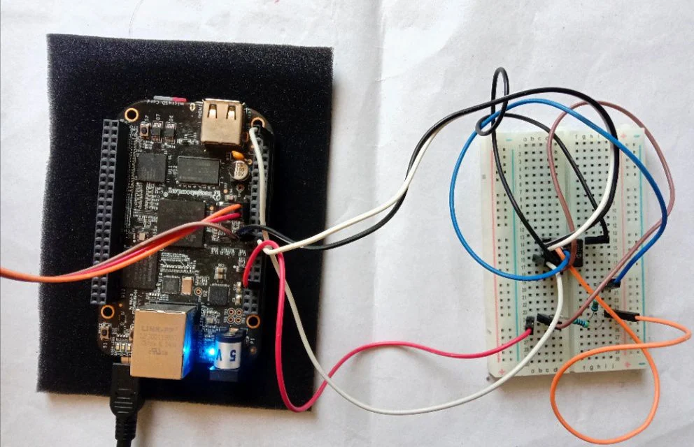

# Linux I2C driver for the 24FC02 EEPROM

An out-of-tree Linux kernel module for the Microchip 24xx02 family of 2 Kbit
(256 x 8) I2C serial EEPROMs (24AA02 / 24LC02B / 24FC02). It binds to an I2C
client and exposes the EEPROM through two interfaces: sysfs attributes (hex
text) and an optional character device (raw bytes).

- [Datasheet](https://ww1.microchip.com/downloads/en/DeviceDoc/24AA02-24LC02B-24FC02-2K-I2C-Serial-EEPROM-20001709N.pdf)



## Features

- Binds via the I2C device ID table or Device Tree (`ee24c02`).
- **sysfs interface**: read and write the EEPROM as hex bytes, with input
  validation.
- **Character device** (`/dev/eeprom`, optional at build time): `read`,
  `write` and `llseek` with raw bytes.
- **Page-aware writes**: data is split on 8-byte page boundaries, with a 10 ms
  wait after each page write for the internal write cycle.
- **Address pointer tracking**: the driver keeps a per-device address pointer
  that advances after every read and write.
- **Locking**: a per-device mutex serializes I2C transactions, so the sysfs and
  character device paths can be used at the same time.

## Repository layout

```
.
├── Makefile              # Kbuild + helper targets (host, qemu)
├── Kconfig               # Reserved, currently empty
├── core/
│   ├── at24c02_core.c    # I2C driver, probe/remove, sysfs attributes
│   ├── at24c02_i2c.c     # I2C read/write helpers (locking, page-aware writes)
│   └── at24c02_chrdev.c  # Optional character device
├── include/
│   └── at24c02_priv.h    # Constants, struct at24c02, shared declarations
└── LICENSE               # GPL-2.0
```

The module is built as `at24c02_drv.ko`.

## Requirements

- A C toolchain matching the kernel (and a cross toolchain if you target ARM).
- A board or emulator with a 24xx02 on an I2C bus. The device responds at
  7-bit addresses `0x50`-`0x57`, selected by the A0-A2 pins.

## Building

Build against the running kernel:

```sh
make host
```

Build against a specific kernel build tree:

```sh
make KERNELDIR=/path/to/kernel/build modules
```

Cross-compile for ARM (for example, to run under QEMU):

```sh
make qemu QEMUDIR=/path/to/kernel/build QEMU_CC=arm-linux-gnueabihf-
```

> **Note:** the default `KERNELDIR`, `QEMUDIR` and `QEMU_CC` values in the
> Makefile point at paths on my machine. Override them as shown above
> or edit the Makefile.

Enable the character device interface:

```sh
make host CONFIG_AT24C02_CHARDEV=y
```

Clean:

```sh
make clean
```

The module is built with `-DDEBUG`, so `pr_debug()` output is enabled.

## Usage

### 1. Load the module

```sh
sudo insmod at24c02_drv.ko
```

### 2. Describe the device

**Device Tree**, as a child of your I2C controller node:

```dts
&i2c1 {
	eeprom@50 {
		compatible = "ee24c02";
		reg = <0x50>;
	};
};
```

**Or instantiate it at runtime** (the I2C ID is `ee24c02`):

```sh
echo ee24c02 0x50 | sudo tee /sys/bus/i2c/devices/i2c-1/new_device
```

Replace `i2c-1` with the bus your EEPROM is on. On a successful probe the log
shows `at24c02 probed`. To remove it again:

```sh
echo 0x50 | sudo tee /sys/bus/i2c/devices/i2c-1/delete_device
```

> Only one EEPROM instance is supported at a time: the character device and
> class are registered under the fixed name `eeprom`.

### 3. sysfs interface

The attributes appear under the I2C client directory, for example
`/sys/bus/i2c/devices/1-0050/`.

| Attribute | Access | Description |
|-----------|--------|-------------|
| `eeprom` | read/write | Read the full 256 bytes, or write bytes starting at a given address |
| `address` | read/write | Current address pointer, in hex |
| `capacity` | read-only | EEPROM size in bytes (`256`) |
| `page_size` | read-only | Page write size in bytes (`8`) |

**Read** the whole EEPROM as hex bytes:

```sh
cat /sys/bus/i2c/devices/1-0050/eeprom
# 0xff 0xff 0xff ...
```

**Write** by passing the start address followed by the data bytes, all in hex
and separated by whitespace:

```sh
# Write 0xde 0xad 0xbe 0xef starting at address 0x10
echo "0x10 0xde 0xad 0xbe 0xef" | sudo tee /sys/bus/i2c/devices/1-0050/eeprom
```

Notes on writes:

- The first value is always the start address; at least one data byte must
  follow it.
- Every value must be a valid hex byte (`0x..` or bare hex); anything else is
  rejected with an error in the kernel log.
- Writes that cross an 8-byte page boundary are split into separate page
  writes automatically.
- Input must be shorter than one page of text (`PAGE_SIZE - 1` characters).

**Address pointer.** The driver advances `address` after each read or write
to the byte following the last one accessed. You can also set it by hand:

```sh
cat /sys/bus/i2c/devices/1-0050/address                   # 0x00
echo 20 | sudo tee /sys/bus/i2c/devices/1-0050/address    # sets 0x20 (hex)
```

`eeprom` reads always start at address `0x00`; the `address` attribute does
not change where they start.

### 4. Character device

With `CONFIG_AT24C02_CHARDEV` enabled, a probed device creates
the `eeprom` class and the `/dev/eeprom` node.

| Operation | Behavior |
|-----------|----------|
| `read` | Reads from the current file offset, up to the end of the EEPROM. Returns `0` at offset 256. |
| `write` | Raw bytes: the **first byte is the EEPROM address**, the remaining bytes are data. At least one data byte is required. Page boundaries are handled automatically. |
| `llseek` | `SEEK_SET`, `SEEK_CUR` and `SEEK_END` are supported. Valid offsets are `0` to `256`; there is no wrap-around, and anything outside that range returns `EINVAL`. |

**Read** the whole EEPROM:

```sh
sudo hexdump -C /dev/eeprom
```

**Write** `de ad be ef` starting at address `0x10`. The first byte is the
address, so the payload is five bytes:

```sh
echo '\x10\xde\xad\xbe\xef' | sudo tee /dev/eeprom
```

Keep in mind that `write` takes the address from the data itself, not from the
file offset. The offset only limits how many bytes are accepted, and it
advances by the number of bytes written (address byte included).

## Unloading

```sh
sudo rmmod at24c02_drv
```

## Contributing

Issues and pull requests are welcome. The repository includes a `.clang-format`
file that follows the kernel coding style; please format changes with it.

## License

Licensed under the GNU General Public License v2.0 only. See [LICENSE](LICENSE).

## Author

[Ankit Khushwaha](https://github.com/ankitkhushwaha)
